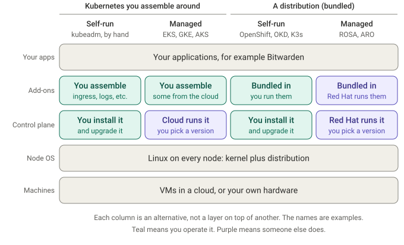

# 00 - Why OpenShift, and why ROSA

**Goal:** This chapter includes information on OpenShift - what it is, where it sits among the other ways of running Kubernetes, and why I used ROSA with hosted control planes (HCP) for this lab. Nothing is getting built yet here, just laying the groundwork and understanding for the infrastructure.

**Cost check:** nothing in this chapter bills, because no AWS resources exist yet.

## Why I chose to build an OpenShift cluster
Bitwarden released a Helm chart of the self-hosted application a couple of years ago, and some people run their self-hosted Kubernetes instances on OpenShift. If something behaves unexpectedly there, it can be specific to OpenShift itself, like how traffic is routed in, or which users a container is allowed to run as, so a plain Kubernetes cluster from another provider might not reproduce it.

I wouldn't keep a cluster running around the clock because of the cost, so the goal of this lab is to document the steps for deploying a fully operational OpenShift cluster that I can put the Bitwarden Helm chart on. That way I (or anyone following along) can spin one up when needed, use it, and delete it again with a full teardown, to avoid incurring more charges than necessary.

## Understanding what OpenShift is
Reference - the terms I'm using:
+ **Kubernetes** (upstream Kubernetes, the open-source project) is like an operating system for a cluster. Many machines, possibly in many places, behaving as if they were one. Each machine still has its own Linux operating system underneath - Kubernetes doesn't talk to the hardware itself. Instead, on each node, the kubelet tells a container runtime (OpenShift uses CRI-O) which container images to pull and which containers to start or stop, and the runtime asks the node's Linux kernel to isolate them and limit the CPU and memory they can use.
+ **On its own, Kubernetes isn't a complete platform.** The control plane (the API server, etcd, the scheduler and the controllers) decides what runs where, but you still have to choose the pieces around it: a network plugin for the pods, storage drivers, something to route traffic in, monitoring, logging, and a way for people to log in.
+ **A Kubernetes distribution** is Kubernetes packaged together with a chosen set of those pieces (usually with its own installer and upgrade process), tested together and supported by a vendor or project. OpenShift, OKD, RKE2 and K3s are Kubernetes distributions. Like a Linux distribution such as Ubuntu or RHEL, it bundles things around a core, but there's one difference: you don't need a Kubernetes distribution to run Kubernetes. Upstream Kubernetes works on its own, and you can run it yourself (adding pieces like the network plugin as you go) or have a cloud provider run it for you. A distribution is a way to have the surrounding pieces chosen and supported for you. With Linux it's different: you normally have to use a distribution like Ubuntu or RHEL, because the kernel on its own isn't something you can use directly.
+ **A managed service** means someone else operates something for you, the same way Amazon RDS saves you from installing and running a database on your own VM. For Kubernetes, that starts with the control plane: you get a Kubernetes API to talk to, and you don't see or maintain the machines it runs on. EKS, GKE and AKS are managed Kubernetes services. ROSA, ARO and OpenShift Dedicated are managed services too: they're OpenShift, a Kubernetes distribution, operated for you, which includes platform components such as the router and platform monitoring, as well as the control plane.

So there are two separate questions: **what's in the box** (Kubernetes that you assemble the surrounding pieces for, or a distribution that bundles them), and **who operates it** (you, or someone else). Here's where each name falls:

| | You install and operate it | Someone else operates it |
|---|---|---|
| Kubernetes without a bundled platform: you choose and assemble the surrounding pieces | Installed yourself, for example with kubeadm (the Kubernetes project's installer) or by hand, as in [Kubernetes the Hard Way](https://github.com/kelseyhightower/kubernetes-the-hard-way) | EKS, GKE, AKS |
| A distribution: Kubernetes bundled with a chosen set of pieces | OpenShift, OKD, RKE2, K3s | ROSA, ARO, OpenShift Dedicated (all OpenShift, operated for you) |

Which pieces come ready-made on EKS, GKE and AKS varies by cloud (some are offered as optional add-ons), so "you assemble" is a simplification.

The point of this diagram is that the columns are alternatives, not layers. OpenShift doesn't run on top of EKS or GKE, it takes the place of the Kubernetes layer they provide. ROSA runs the worker nodes as EC2 instances in your own AWS account (with hosted control planes, Red Hat runs the control plane in its own account), and no EKS is involved.

### What OpenShift adds
These are the parts I actually ran into during the lab:
+ **Operators everywhere.** `oc get co` lists about twenty cluster operators, one each for DNS, ingress, networking, storage, monitoring and so on. The platform installs and upgrades itself through them, and I added the EFS driver in the same way.
+ **A built-in router and Routes.** OpenShift routes traffic in with its own Route objects and its own router, so I didn't have to choose and install an ingress controller.
+ **Strict security defaults.** Security context constraints (SCCs) decide what a pod is allowed to do, including which users it may run as. This caused the one real surprise in the lab (the SQL Server pod, which I'll bring up in chapter 06).
+ **A console, monitoring, an image registry and identity integration** - all ready to use, plus the `oc` command line tool, which is a superset of `kubectl` and works much the same way.

### Who runs what
This is a simplified version of where the management starts and ends. Red Hat and AWS publish the official responsibility matrix (linked in the sources below), so check that for the exact split.

| Layer | EKS | ROSA with hosted control planes | OpenShift you run yourself |
|---|---|---|---|
| Data centre and hardware | AWS | AWS | You, or your cloud account |
| Control plane | AWS | Red Hat, in its own account | You |
| Platform pieces (router, monitoring, registry, networking) | You choose, install and upgrade them | Bundled, operated and upgraded by Red Hat | Bundled, and you operate and upgrade them |
| Worker nodes | You size them and plan their upgrades | You size them and pay AWS for them, and the platform manages their software | You |
| Your apps, identity provider, backups, scaling | You | You | You |

One detail from Red Hat's shared responsibility model: maintaining the versions of the control plane and the worker nodes is Red Hat's job, so I wouldn't patch node software myself. I still choose the machine size and keep an eye on worker capacity.

Random supporting point that came up while I was working on understanding the value of using OpenShift: ingress-nginx is a good example of why bundling matters. In early 2026, the Kubernetes community retired the ingress-nginx controller because it didn't have enough maintainers, so anyone using it (on EKS, for example) had to migrate. OpenShift's built-in router is a different component, based on HAProxy and managed by the platform's Ingress Operator, with a vendor behind it, so people using it weren't affected. It's a pretty solid example of the difference a bundled service like OpenShift makes (see the sources below).

## Why not just use EKS (or GKE or AKS)?
For running Bitwarden itself, EKS works fine, and Bitwarden has a deployment guide for it. I opted for OpenShift to replicate what happens when people deploy Bitwarden on it, and this lab is a guide for doing that. Three things in this lab wouldn't have shown up on EKS: Routes in place of an ingress and the security constraints on the SQL pod (both OpenShift behaviour), and the extra identities ROSA needs (specific to ROSA rather than OpenShift in general).

## The options I looked at
I didn't do an exhaustive comparison, but this is the list I ended up with to evaluate, roughly in the order I came across it.

| Option | What it is | Who runs it | Where it landed for me |
|---|---|---|---|
| EKS, GKE or AKS | The cloud's managed Kubernetes | The cloud | Easiest/fastest option for spinning up Bitwarden on Kubernetes itself, but doesn't cover what people using OpenShift run |
| OKD on one large VM | The community version of OpenShift, run here as a single node on one VM | Me | Free software and cheaper to run, but it's the community build rather than the supported one, and a single node (the setup I heard about) can't reproduce multi-node behaviour, which made ROSA feel like the closer match |
| OpenShift Local (CRC) | A small OpenShift on a laptop | Me | Free, but no real cloud storage, DNS or load balancer (which can be where much of the trouble lives) |
| OpenShift you install yourself | The supported product, multi-node | Me | The most faithful, I'd expect, but I didn't try it: more machines to set up and pay for, so probably slower to set up and costlier to leave running |
| OpenShift Dedicated | Managed OpenShift, run and supported by Red Hat | Red Hat | Runs on AWS or Google Cloud, in a Red Hat-owned account or your own. I didn't look at it too closely, but ROSA's single AWS bill suited what I was looking for more |
| ARO | Managed OpenShift on Azure | Microsoft and Red Hat | Same idea as ROSA, on Azure instead (I kind of prefer to navigate AWS over Azure for something new by default) |
| ROSA, classic | Managed OpenShift on AWS | Red Hat (the control plane runs in my account) | Works, but more machines to run and pay for |
| ROSA with hosted control planes | Managed OpenShift on AWS | Red Hat (the control plane runs in Red Hat's account) | What I chose |

Reference - OpenShift Dedicated vs ROSA: both are fully managed OpenShift, operated by Red Hat's site reliability engineers. OpenShift Dedicated is Red Hat's own service, available on AWS and Google Cloud, with support through Red Hat. ROSA is a joint service with AWS: support from either, one AWS bill, and closer integration with AWS (the IAM roles in chapter 02).

## Why ROSA with hosted control planes
Being completely honest, I wasn't deeply invested in choosing ROSA. Someone mentioned ROSA and ARO, and between the two I'd rather spend time on AWS. I'd already started researching ROSA when I heard that you can also run OKD on a single large VM on GCP (which is where I usually spin up my Docker Compose deployments), mainly to keep costs down. OOKD is the community upstream, and the setup I heard about was a single node on one VM, which made ROSA feel like the closer match, as long as I could keep tight control of what was running to manage cost. Both are reasonable, and ROSA turned out to fit what I needed:
+ **It's a multi-node cluster of the supported product**, so it behaves much more like a customer's environment.
+ **Billing is by the hour, through AWS.** I pay for the cluster only while it exists, which suits the create, test, delete I was going for. I'm very cloud-cost-conscious (I'm the one who reminds people to switch off idle VMs), so there are cost checks throughout to show rough estimates of costs.
+ **With hosted control planes, Red Hat runs the control plane in its own account.** I only run the worker nodes (two is the minimum here), I pay a per-cluster fee instead of running control plane machines, and the cluster was ready in about 10 to 15 minutes.

Reference - classic vs hosted control planes: in classic ROSA, the control plane machines run in your own account, so there are more machines to run and pay for, and installing takes longer. With hosted control planes, they run in Red Hat's account. The setup steps are similar either way (roles, OIDC provider, network, cluster), but with HCP, you need to bring your own Virtual Private Cloud (VPC), which is why chapter 03 builds a VPC.

Random note: the `--mode auto` and `--mode manual` options on the `rosa` commands are a different thing. They decide whether the CLI creates the AWS resources for you or prints the commands for you to run.

## Sources for this chapter
+ [ROSA pricing page](https://aws.amazon.com/rosa/pricing/)
+ [Ingress NGINX retirement statement](https://kubernetes.io/blog/2026/01/29/ingress-nginx-statement/)
+ [ROSA: Who does what? (Red Hat blog, May 2023)](https://www.redhat.com/en/blog/red-hat-openshift-service-aws-rosa-who-does-what): a readable overview of what "managed" means. It predates hosted control planes, so use the responsibility overview below
+ [Overview of responsibilities for ROSA (AWS docs)](https://docs.aws.amazon.com/rosa/latest/userguide/rosa-responsibilities.html)
+ [ROSA architecture models (AWS docs)](https://docs.aws.amazon.com/rosa/latest/userguide/rosa-architecture-models.html): classic vs hosted control planes
+ [ROSA with hosted control planes now available (Red Hat blog)](https://redhat.com/en/blog/red-hat-openshift-service-aws-hosted-control-planes-now-available)
+ [ROSA FAQs](https://www.redhat.com/en/technologies/cloud-computing/openshift/aws/faq)
+ [OpenShift Ingress Operator (GitHub)](https://github.com/openshift/cluster-ingress-operator)